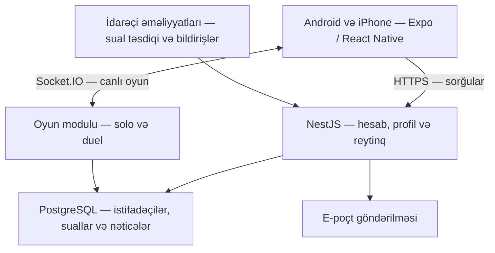

# Azərbaycan bilik yarışması — kod arxitekturası

Tarix: 6 oktyabr 2026 · Versiya: 1.0 · Status: istifadəçi tərəfindən təsdiqlənib

Bu sənəd tətbiqin necə qurulacağını müəyyənləşdirir. İstifadəçi arxitekturanı təsdiqləyib və clean code tələbini vurğulayıb. Hazırda yalnız VS Code workspace-i, qovluq quruluşu və format qaydaları hazırlanır; tətbiq kodu, yeni database cədvəlləri, server və xidmətlər yaradılmayıb. Seçilmiş göy-qızılı Studiya dizaynı əsas götürülür: `output/design/son-dizayn-2026-10-05/BAXIS.html`.

## 1. Əsas qərar

**Bir ortaq layihədə Android/iOS mobil tətbiqi, bir modul əsaslı oyun serveri və mövcud PostgreSQL bazası.**

Serverin daxilində hissələr ayrı modullarda olacaq, lakin ilk versiya bir server prosesi kimi işləyəcək. Bu, kiçik başlanğıc üçün sadədir və yük artanda lazım olan hissələri ayırmağa imkan verir. Mikroservislər, Kubernetes və Redis ilk mərhələnin tələbi deyil.

Telefon interfeysi göstərir və oyunçunun seçimini göndərir. Server sualı seçir, vaxtı yoxlayır, cavabı qiymətləndirir, qalibi və rankı hesablayır. PostgreSQL davamlı həqiqət mənbəyidir; telefon və server yaddaşı onun əvəzi deyil.



Diaqram tətbiqin yayım quruluşunu göstərir. Yerli sınaqda server kompüterdə işləyəcək; telefonlar kompüterin şəbəkə ünvanına qoşulacaq.

## 2. Texnologiyalar və onların işi

| Hissə | Seçim | Bu layihədə məsuliyyəti |
|---|---|---|
| Mobil tətbiq | React Native + Expo + TypeScript | Android və iOS üçün ortaq ekranlar və davranış |
| Səhifələr arası keçid | Expo Router | Giriş, əsas menyu və oyun ekranlarının naviqasiyası |
| Serverdən alınan məlumat | TanStack Query | Profil, tarixçə və reytinqin alınması, keşlənməsi və yenilənməsi |
| Telefonda cari vəziyyət | Zustand | Seçilmiş cavab, canlı oyunun serverdən alınmış nüsxəsi, səs/titrəmə seçimləri |
| Dizayn | React Native StyleSheet + ortaq tema | Studiya rəngləri, ölçülər, yazılar və komponentlər |
| Animasiya və qrafik elementlər | Reanimated + react-native-svg | Qısa keçidlər, vaxt göstəricisi, ikon və fon elementləri |
| Giriş məlumatının cihazda saxlanması | Expo SecureStore | Yenilənmə tokeninin saxlanması |
| Server | NestJS + TypeScript | Hesablar, oyun qaydaları, canlı əlaqə və idarəçi əməliyyatları |
| Canlı əlaqə | Socket.IO | Sualın açılması, cavabın qəbulu, hesab və mərhələ dəyişməsi |
| Database | Mövcud PostgreSQL | Davamlı məlumatlar, tranzaksiyalar və məhdudiyyətlər |
| Database ilə kod əlaqəsi | Prisma + lazım olan yerdə parametrli SQL | Cədvəl modelləri, tətbiq sxeminin dəyişiklikləri və tranzaksiyalar |
| Ümumi məlumat formaları | TypeScript + Zod | Sorğu, cavab və hadisələrin formatı; giriş məlumatlarının yoxlanması |
| Layihə təşkili | npm workspaces | Mobil, server və ortaq müqavilələrin bir repoda saxlanması |

Expo Router fayl əsaslı naviqasiyanı, Expo isə npm workspaces daxil olmaqla monorepo quruluşunu dəstəkləyir. Bu dəstəkdən istifadə edəcəyik. [Expo Router](https://docs.expo.dev/router/introduction/), [Expo monorepo sənədi](https://docs.expo.dev/guides/monorepos/).

TanStack Query React Native üçün server məlumatlarının idarəsinə uyğundur; Zustand ayrıca lokal vəziyyət üçün seçilir. Eyni profil və reytinq məlumatını iki yerdə saxlamayacağıq. [TanStack Query](https://tanstack.com/query/latest/docs/framework/react/react-native), [Zustand](https://github.com/pmndrs/zustand).

SecureStore cihazda qorunan saxlama təmin edir. Reanimated və SVG üçün Expo sənədlərindəki uyğun versiyalar seçiləcək. Bütün paketlərin dəqiq versiyaları layihə qurulanda Expo Go uyğunluğuna əsasən yoxlanıb lockfile-da sabitlənəcək. [SecureStore](https://docs.expo.dev/versions/latest/sdk/securestore/), [Reanimated](https://docs.expo.dev/versions/latest/sdk/reanimated/), [SVG](https://docs.expo.dev/versions/latest/sdk/svg/).

## 3. Planlaşdırılan qovluq quruluşu

Aşağıdakı ağaca uyğun boş layihə qovluqları hazırlanıb. Tətbiq mənbə faylları hələ yazılmayıb. Mövcud sual bankı və dizayn faylları yerində qalır.

```text
C:\project3
├── apps/
│   ├── mobile/
│   │   ├── app/                    Səhifə keçidləri və layout-lar
│   │   ├── src/
│   │   │   ├── features/           auth, home, solo, duel, ranks,
│   │   │   │                       leaderboard, profile, history,
│   │   │   │                       settings, reports, support
│   │   │   ├── components/         Ortaq ekran elementləri
│   │   │   ├── theme/              Rəng, yazı, ölçü və animasiya qaydaları
│   │   │   ├── services/           HTTP, socket, token və cihaz xidmətləri
│   │   │   ├── stores/             Sessiya, canlı oyun və seçimlər
│   │   │   ├── hooks/              Ortaq davranışlar
│   │   │   └── content/            Azərbaycan dilində interfeys mətnləri
│   │   ├── assets/                 Fon, ikon, şrift və səs
│   │   └── tests/
│   └── api/
│       ├── src/
│       │   ├── modules/            Server modulları
│       │   ├── infrastructure/     Database, scheduler, e-poçt, outbox
│       │   ├── common/             Giriş yoxlaması, xəta, limit və log
│       │   └── config/             Mühit və xidmət parametrləri
│       ├── prisma/                 Yalnız tətbiqin idarə etdiyi sxem
│       └── tests/
├── packages/
│   ├── contracts/                  Açıq API/socket formatları və Zod sxemləri
│   └── tooling/                    Ortaq lint və TypeScript konfiqurasiyası
├── docs/                           API, baza və sınaq sənədləri
├── question-bank/                  Mövcud sual hazırlama bankı
├── output/design/                  Hazır dizayn şəkilləri
└── compose.yaml                    Yerli PostgreSQL və gələcək yerli xidmətlər
```

`packages/contracts` yalnız telefona verilə bilən məlumatları daşıyır. Düzgün cavab açarları, sual mənbələri, şifrə məlumatları və daxili oyun qaydası kodu mobil paketə daxil edilməyəcək. Database modelləri birbaşa API cavabı kimi qaytarılmayacaq.

## 4. Mobil hissənin sərhədləri

`app/` faylları ekran keçidlərini müəyyənləşdirir; ağır oyun və şəbəkə məntiqini daşımır. Hər funksiyanın ekranları, məlumat sorğuları və davranışı öz `features/` qovluğunda yerləşir.

Naviqasiya üç qrupa bölünür:

- Hesab ekranları: qarşılama, giriş, qeydiyyat, bərpa və e-poçt təsdiqi.
- Əsas menyu: Ana səhifə, Duel, Reytinq, Profil.
- Fokus ekranları: canlı sual, dost otağı, nəticə, rank dəyişikliyi və təsdiq pəncərələri.

Canlı oyun zamanı səhifə keçidi oyunu səssizcə tərk etməyəcək. Çıxış təsdiqi və server əmri tələb olunur. Bildiriş, bağlantı problemi, düzgün/səhv cavab və vaxt bitməsi üçün ayrıca lazımsız səhifələr açılmayacaq; bunlar ekran vəziyyətləri və pəncərələr kimi qurulacaq.

Ortaq komponentlər: `StudioScreen`, `StudioHeader`, `GoldButton`, `AnswerOption`, `QuestionPanel`, `Countdown`, `DuelScoreboard`, `RankBadge`, `RankProgress`, `PlayerAvatar`, `ResultSummary`, `FormField`, `ConfirmDialog`, `ConnectionBanner`.

Məlumat bölgüsü:

| Məlumat | Yeri |
|---|---|
| Profil, tarixçə, liderlər | TanStack Query |
| Cari oyun vəziyyəti və onun revision-u | Yalnız game store; serverin nüsxəsi |
| Cavabın seçilməsi, açıq pəncərə | Ekranın lokal vəziyyəti |
| Yenilənmə tokeni | SecureStore |
| Qısa müddətli access token | Yaddaş |
| Səs, titrəmə və azaldılmış animasiya | Lokal seçimlər |
| Rank və yarış xalının əsas hesabı | Server/PostgreSQL |

Telefon serverdən gələn vaxtı ekranda göstərir. Animasiya bitməsi, ekranda 0 görünməsi və ya tətbiqin arxa plana keçməsi serverdə nəticə yaratmır. Cavab göndəriləndə düymə gözləmə vəziyyətinə keçir; təsdiq alınmadan “qəbul edildi” yazılmır.

## 5. Server modulları

| Modul | Məsuliyyət |
|---|---|
| Auth | Qonaq, qeydiyyat, giriş, token yeniləmə, e-poçt təsdiqi və bərpa |
| Users | Profil, görünən ad, hesab statusu və avatar rəngi |
| Questions | Təsdiqlənmiş sual versiyaları, daxili seçim və təkrarların məhdudlaşdırılması |
| Games | Solo/duel vəziyyəti, sual vaxtı, cavab qəbulu və nəticənin yekunlaşdırılması |
| Matchmaking | Ranklı rəqib axtarışı, gözləmə növbəsi və uyğunlaşdırma |
| Rooms | Dost otağı, kod, iştirakçılar və hazır olma |
| Rankings | Ayrı solo/duel rankı, pillələr və rank əməliyyatları |
| Statistics | Düzgün cavab faizi, oyun və qələbə/məğlubiyyət göstəriciləri |
| Leaderboards | Solo və duel sıralamaları, oyunçunun öz yeri |
| Reports / Support | Sual bildirişləri və dəstək müraciətləri |
| Admin | Sual yayımlama, bildiriş baxışı və audit |

Oyun qaydasını yalnız `Games` təşkil edir. HTTP controller və socket gateway eyni oyun əməliyyatlarını çağırır; iki ayrı xal hesablama yolu olmayacaq. NestJS gateway bu əlaqə qatını təşkil etməyə imkan verir. [NestJS gateway sənədi](https://docs.nestjs.com/websockets/gateways).

Oyun modulunun daxilində ayrılıq:

```text
games/
├── domain/            Vəziyyət keçidləri, vaxt və xal qaydaları
├── application/       StartGame, SubmitAnswer, CloseQuestion,
│                      LeaveGame, ResumeGame, FinalizeGame
├── transport/         HTTP controller və socket gateway
└── persistence/       Oyunun saxlanması və məlumat oxunması
```

Domain hissəsi React Native, HTTP və Socket.IO-dan asılı olmayacaq. Başqa modullar Games cədvəllərinə sərbəst dəyişiklik etməyəcək. Rankings və Statistics nəticə tranzaksiyası daxilində çağırılan əməliyyatlar təqdim edəcək.

## 6. Oyun qaydalarının bir yerdə saxlanması

| Çətinlik | Vaxt | Düzgün yarış xalı | Solo düzgün | Solo səhv | Cavabsız |
|---|---:|---:|---:|---:|---:|
| Asan | 20 san | +20 | +5 | −3 | 0 |
| Orta | 25 san | +25 | +8 | −4 | 0 |
| Çətin | 30 san | +30 | +12 | −5 | 0 |

Əsas tur: 2 asan + 5 orta + 3 çətin, maksimum 255 yarış xalı. Səhv və cavabsız sual yarışda 0 xal verir. Rank minimum 0-dır.

Ranklı duel yalnız yekunda +25/−25 verir; sualbaşına solo rank cədvəli dueldə tətbiq edilmir. Dost dueli rank dəyişdirmir. Solo və duel ayrı balans və tarixçəyə malikdir.

Qaydalar serverdə versiyalı `game_rules` konfiqurasiyasında saxlanacaq. Yeni oyun başladıqda həmin versiya və lazımi parametrlər oyuna bağlanır. Oyunun ortasında balans dəyişiklikləri onun hesabını dəyişməyəcək. Mobil tətbiq yalnız göstərilməli vaxt/xal izahını serverdən alır.

Rank pillələri üçün son təklif Şagird → Tədqiqatçı → Alim → Müdrik → Əllamə, hərəsində III → II → I-dir. 100/150/200/250/300 xallıq alt pillə ölçüləri hələ balans təklifidir; arxitektura bu sərhədlərin sonradan konfiqurasiya ilə dəyişməsini nəzərdə tutur.

## 7. Database quruluşu

Mövcud `quiz_az` bazası saxlanır. `question_bank.questions` hazırlama bankıdır; tətbiq cədvəlləri ayrıca `app` sxemində olacaq. Prisma migration-ları mövcud bankı idarə etməyəcək, silməyəcək və yenidən yaratmayacaq. Prisma PostgreSQL üçün çoxsxemli modelləri dəstəkləyir; bizim migration sərhədimiz yalnız yeni tətbiq sxemidir. [Prisma sxem sənədi](https://www.prisma.io/docs/orm/prisma-schema/data-model/multi-schema).

| Cədvəl | Əsas məlumat |
|---|---|
| users | UUID, guest/registered, username, email, hash, status, email_verified_at |
| profiles | user_id, görünən ad, avatar rəngi |
| sessions | user_id, yenilənmə tokeninin hash-i, müddət, ləğv və rotasiya |
| auth_challenges | E-poçt kodu/bərpa tokeninin hash-i, müddət, cəhd və istifadə vaxtı |
| game_rules | Versiya, çətinlik parametrləri, rank sərhədləri və duel qaydaları |
| question_versions | Bank ID-si, versiya, sual və variantlar, gizli düzgün cavab, təsdiq |
| matches | Rejim, vəziyyət, qayda versiyası, revision, current_question_id, nəticə səbəbi |
| match_players | İştirakçı, qəbul statusu, yarış xalı, bağlantı büdcəsi və nəticə |
| active_game_memberships | Oyunçunun hazırda aid olduğu tək aktiv oyun |
| match_rounds | Əsas/əlavə mərhələ, nömrə və vəziyyət |
| match_questions | Sual nüsxəsi, sıra, variant xəritəsi, açılma və son vaxt, bağlı/açıq status |
| answers | İştirakçı, oyun sualı, seçilən variant və ya cavabsız, düzgünlük və xal |
| match_results | Oyun üzrə bir yekun qərar, qalib/iki texniki məğlub/solo və səbəb |
| player_ranks | user_id + solo/duel, cari rank xalı və ardıcıl əməliyyat nömrəsi |
| rank_ledger | Oyun, əvvəlki xal, nəzəri delta, faktiki delta və son xal |
| player_stats | Yekunlaşdırılmış nəticələrdən yaranan göstəricilər |
| question_exposures | Oyunçuya göstərilmiş sual, mövzu və vaxt |
| matchmaking_entries | Gözləyən oyunçu, rank, müddət və vəziyyət |
| friend_rooms / room_members | Kod, sahibi, son müddət, iştirakçılar və hazır olma |
| question_reports / support_tickets | Müraciət, istifadəçi, səbəb və baxış statusu |
| command_receipts | Təkrar əmrin tanınması və əvvəlki nəticəsi |
| event_outbox | Tranzaksiyadan sonra göndəriləcək oyun/e-poçt hadisələri |
| admin_audit | İdarəçi əməliyyatlarının vaxtı, səbəbi və icraçısı |

Bunlar məntiqi cədvəllərdir; tam sütunlar və indekslər həyata keçirmə sxemində hazırlanacaq. `question_versions.bank_id` mövcud bankın AZQ identifikatorunu saxlayır; hazırlama bankından oyun məlumatına silmə kaskadı olmayacaq.

Əsas əlaqə: users → match_players → matches; matches → match_rounds → match_questions; answers → match_player + match_question; match_results → rank_ledger → player_ranks. Eyni baza tranzaksiyası nəticə, rank, statistika və outbox yazılarını birlikdə bağlayacaq.

Məhdudiyyətlər:

- `users.username_normalized` və qeydiyyatlı hesabın `email_normalized` dəyəri təkrarlana bilməz; qonağın e-poçtu yoxdur.
- `answers(match_player_id, match_question_id)` unikal olur; təkrar seçim yeni cavab yaratmır. Cavab yalnız həmin oyunun iştirakçısına və sualına bağlı ola bilər.
- `match_results(match_id)` və `rank_ledger(match_id, user_id, rank_mode)` unikaldır.
- `player_ranks(user_id, rank_mode)` və `active_game_memberships(user_id)` unikaldır. Bir hesab eyni anda solo və duel oynaya bilməz.
- Sual versiyasında düz dörd variant və həmin variantlardan biri olan düzgün cavab olmalıdır.
- Keçmiş oyunun sual nüsxəsi və cavab sırası redaktə olunmur.
- Oyunçu və sual qaydası əlaqələri foreign key-lərlə qorunur; cədvəl dəyişiklikləri yalnız migration ilə aparılır.

Əsas indekslər: reytinq üçün `(rank_mode, points DESC, user_id)`; tarixçə üçün `(user_id, finished_at DESC)`; scheduler üçün açıq sualın `deadline_at`-ı; seçim üçün yayımlanmış çətinlik/mövzu; göstərilmə tarixçəsi üçün `(user_id, question_version_id)`.

Telefon PostgreSQL-ə qoşulmayacaq. Oyun runtime-ı `quiz_admin` istifadə etməyəcək. Migration, oyun və sual yayımlama üçün ayrı səlahiyyətlər olacaq; hazırlama bankının parolu mobil tətbiqə daxil edilməyəcək.

## 8. Sualların yayımlanması və seçilməsi

Hazır fayldakı məlumata görə bankda 1950 `review_ready` sual var: 205 asan, 1022 orta, 723 çətin. Bu status ictimai yayım təsdiqi ilə eyni deyil. Bu mərhələdə bazadakı canlı say yenidən yoxlanmayıb və sual bankına dəyişiklik edilməyib.

Yayım yolu: bankdan oxu → mətn/variant/düzgün cavab yoxlaması → təkrar və fact_key yoxlaması → idarəçi təsdiqi → dəyişməz question_version. Sınaq üçün ayrıca test sual dəsti seçilə bilər; hazırlanmış bütün bank avtomatik ictimai oyuna açılmayacaq.

Bank payload-undakı köhnə `points` sahəsi oyun xalını müəyyənləşdirməyəcək. Yarış xalı yuxarıdakı qayda versiyasından götürülür. Beləliklə, bankdakı 10/20/30 ilə razılaşdırılmış 20/25/30 qarışmır.

Hər əsas oyun üçün 2/5/3 sual seçilir, sonra ümumi sıra qarışdırılır. Duelin iki iştirakçısına eyni sual, eyni sıra və eyni variant düzülüşü verilir. Variantlar sual seçiləndə qarışdırılıb xəritəsi saxlanır; qoşulma zamanı yenidən qarışdırılmır.

Eyni oyunda eyni sual və eyni fact_key təkrarlanmır. Mövzu müxtəlifliyi qorunur; oyunçuya kateqoriya seçimi göstərilmir. Son oyunlarda hər iki iştirakçıya göstərilmiş suallar mümkün qədər kənarlaşdırılır. Bank daraldıqda əvvəlki oyunlar üzrə bu yumşaq filtr zəifləyə bilər; cari oyunda təkrar qadağası zəifləməz. Bütün oynayışlar arasında həmişə sıfır təkrar vəd edilmir.

Bərabərlikdə yeni 3 sual seçilir və hamısı oynanandan sonra hesab yoxlanır. İlkin bölgü təklifi 2 orta + 1 çətindir. Əlavə mərhələyə süni say həddi qoyulmur və sürət qalibi müəyyənləşdirmir. Təkrarsız dəsti yaratmaq üçün bank tükənərsə, oyun `insufficient_questions` səbəbi ilə xalsız ləğv olunur; təsadüfi qalib seçilmir və idarəçiyə xəbər verilir.

## 9. Oyun vəziyyətləri və vaxt

```text
created → ready → countdown → question_open
                              ↓
                         question_closed
                              ↓
             növbəti sual / əlavə mərhələ / settling
                                                   ↓
                                               finished

Başlamamış oyun: cancelled_before_start
Server problemi: cancelled_server
Solo istifadəçi çıxışı: abandoned
Dueldə çıxış/bağlantı itkisi: finished + forfeit səbəbi
```

Axtarış növbəsi və dost otağı oyundan ayrıdır. İki iştirakçı hazır olduqda duel yaranır. Dəqiqləşdirilmiş server başlanğıcından əvvəl çıxış cəriməsizdir; başlanğıcdan sonra duel nəticəsi tətbiq edilir. Geri sayım müddəti də server tərəfindən elan olunur.

Hər sualda `openedAt`, `deadlineAt`, `closedAt` saxlanır. Telefon `serverNow` ilə saat fərqini hesablayır, monoton keçən vaxtla geri sayımı göstərir və geri qoşulmada saatı yenidən uyğunlaşdırır. Hər saniyə database yazısı və socket hadisəsi lazım deyil.

İlkin cavab qəbulu qaydası: serverin giriş qatında ölçülən qəbul vaxtı deadline-dan əvvəldirsə və sual açıqdırsa, cavab qəbul edilir. Deadline-a bərabər/gec vaxt rədd edilir; telefonun göndərdiyi vaxt əsas sayılmır. Gecikmiş və bağlı sualı yenidən açan cavab qəbul edilməz. Şəbəkə ləngiməsi üçün ayrıca bonus vaxt təklifi yoxdur; sınaqda sərhəd davranışı ölçüləcək.

Deadline keçidləri scheduler tərəfindən işə salınır, amma həqiqi son vaxt bazadadır. Scheduler ləngisə belə gec cavab düzgün sayılmır. Cavab və timer əməliyyatı eyni oyun/sual üzərində qısa tranzaksiya və sıra kilidi ilə ardıcıllaşdırılır. Telefon təkbaşına növbəti sualı yarada bilməz.

Solo cavab verəndən sonra qısa nəticə göstərilir, server növbəti sualı açır. Dueldə düzgün cavab yalnız hər iki cavab qəbul ediləndə və ya vaxt bitəndə açıqlanır. Rəqibə cavabın məzmunu əvvəlcədən göndərilmir; yalnız cavab verib-vermədiyi göstərilə bilər.

## 10. Xal və nəticənin bir dəfə yazılması

Rank və statistika hər socket hadisəsində birbaşa artırılmayacaq. Qəbul edilmiş cavablar oyun daxilində saxlanır; yekunlaşdırma onları bir nəticəyə çevirir.

1. Oyun və iştirakçı vəziyyəti kilidlənir; əvvəl yekunlaşdığı yoxlanır.
2. Yarış xalı və nəticə yalnız qəbul edilmiş cavablardan hesablanır.
3. Rank sıraları user_id üzrə sabit ardıcıllıqla kilidlənir.
4. Yeganə result və rank ledger əməliyyatları yazılır.
5. Rank balansı, statistika və aktiv oyun üzvlüyü həmin tranzaksiyada yenilənir.
6. Outbox-a nəticə hadisəsi əlavə olunur; tranzaksiya bağlanandan sonra telefonlara göndərilir.

Xəta olarsa bütün tranzaksiya geri qaytarılır. Cavab təsdiqi və nəticə hadisəsi yalnız database yazısı tamamlandıqdan sonra çıxır. Prisma tranzaksiyaları bu sərhədi qurmağa imkan verir; qarşılıqlı yazılar üçün PostgreSQL sıra kilidləri istifadə edilir. [Prisma tranzaksiyaları](https://www.prisma.io/docs/orm/fundamentals/transactions), [PostgreSQL sıra kilidləri](https://www.postgresql.org/docs/current/explicit-locking.html).

Solo üçün ekrandakı sualbaşına +8/−4 kimi dəyişiklik həmin turun hesabıdır. Daimi solo rankı tur bağlananda yazılır. İstifadəçi turu tərk edəndə artıq yekunlaşdırılmış sualların delta-sı saxlanır; cavabsız suallar 0 verir. Server səbəbindən ləğvdə həmin oyuna heç bir rank əməliyyatı yazılmır. Beləliklə, mənfi cavabı çıxmaqla silmək və server xətasına görə oyunçunu cərimələmək mümkün olmur.

İlkin balans təklifi: solo delta-ları tur üzrə toplanır, sonra minimum 0 sərhədi bir dəfə tətbiq edilir. Bu, sual sırasına görə aşağı sərhəd hesabının dəyişməsini aradan qaldırır. UI-da yekun üçün nəzəri delta ilə faktiki balans dəyişikliyi ayrılır: 10 xalın varsa və delta −25-dirsə, yeni balans 0 və faktiki azalma −10 olur. Bu detal da sənədlə təqdim olunan təklifdir.

Adi duel bir qalib və bir məğlub verir. Hər iki iştirakçı uyğun çıxış/bağlantı şərtini pozarsa, hər ikisi texniki məğlub olur və pulsuz qalib yaranmır. Dost duelinin ledger delta-sı 0-dır. Ləğv edilmiş oyunlar qələbə/məğlubiyyət statistikasına daxil edilmir; yarımçıq solo ayrıca göstərilir və tamamlanmış tur sayını artırmır.

## 11. HTTP və canlı hadisələr

HTTP məlumat almaq və əmrləri göndərmək üçündür; Socket.IO serverdəki dəyişiklikləri çatdırmaq üçündür. Solo cavabı HTTP ilə, duel cavabı socket ilə göndərilə bilər; ikisi də eyni `SubmitAnswer` əməliyyatına düşür. Duel cavabı üçün qorunan HTTP alternativi də mümkündür, yeni hesab yolu yaratmır.

| HTTP qrupu | Əməliyyatlar |
|---|---|
| `/v1/auth` | guest, register, login, refresh, logout, verify-email, forgot/reset-password |
| `/v1/me` | Profil, seçimlər, iki rank, tarixçə, şifrə və hesab əməliyyatları |
| `/v1/games` | Solo başlat, öz aktiv oyununu al, snapshot, cavab, çıxış, nəticə |
| `/v1/matchmaking` | Ranklı axtarışa qoşul/çıx, növbə vəziyyəti |
| `/v1/rooms` | Otaq yarat, kodla qoşul, hazır ol, çıx |
| `/v1/leaderboards` | `mode=solo` və ya `mode=duel`, öz yerin |
| `/v1/question-reports` | Sual haqqında bildiriş |
| `/v1/support` | Müraciət göndər və öz müraciətinin vəziyyətini al |
| `/v1/admin` | İdarəçi sual/yayım/müraciət əməliyyatları |

Socket hadisələri:

| İstiqamət | Hadisə | Məna |
|---|---|---|
| Telefon → server | `game:subscribe` | İştirak etdiyi oyunun vəziyyətinə qoşul |
| Telefon → server | `answer:submit` | commandId, oyun sualı və seçilmiş optionId |
| Telefon → server | `game:resume` | Son gördüyü revision ilə vəziyyəti yenilə |
| Server → telefon | `queue:updated` / `room:updated` | Gözləmə və otaq vəziyyəti |
| Server → telefon | `game:snapshot` | İstifadəçiyə uyğun təhlükəsiz cari vəziyyət |
| Server → telefon | `question:opened` | Cari sual, variantlar və vahid deadline |
| Server → telefon | `answer:accepted` | Yalnız göndərənə cavabın qəbul qəbzi |
| Server → telefon | `question:closed` | Açıqlana bilən cavab nəticəsi və yeni hesab |
| Server → telefon | `round:started` | Əsas və ya əlavə mərhələ |
| Server → telefon | `game:finished` / `game:cancelled` | Yekun nəticə və ya ləğv |

Telefon cavabda xal, düzgünlük və qalib göndərmir. Sual paketi yalnız mətn, variant ID-ləri və mətnləri, nömrə, çətinlik, vaxt və göstərilməli yarış xalını daşıyır. Düzgün cavab və izah yalnız sual bağlı olduqda göstərilə bilər. Gələcək sualların açarları və tam bank ötürülmür.

Hər əmr üçün commandId, hər dəyişiklik üçün artan revision olur. Köhnə revision ekrandakı yeni məlumatın üstünə yazılmır. commandId eyni payload ilə təkrarlanarsa əvvəlki qəbul nəticəsi qaytarılır; eyni ID başqa payload ilə göndərilərsə xəta verilir. Məntiqi cavab üçün ayrıca database unikal məhdudiyyəti də var.

## 12. Bağlantı, təkrar paket və server dayanması

Socket.IO-nun standart davranışı itmiş hər hadisəni avtomatik yenidən çatdırmır, connection recovery də hər vəziyyətdə uğurlu deyil. Buna görə yalnız yenidən bağlanmağa güvənmək olmaz. Tətbiqdə qəbul qəbzi, təkrar əmrin tanınması və snapshot sinxronlaşdırılması ayrıca qurulacaq. [Socket.IO çatdırılma qaydaları](https://socket.io/docs/v4/delivery-guarantees/), [Bərpa davranışı](https://socket.io/docs/v4/connection-state-recovery/).

Bağlantı qayıdanda token və oyuna üzvlük yenidən yoxlanır. Serverdən cari snapshot alınır; keçmiş cavab qalır, sual vaxtı geri qaytarılmır. Telefon deadline-ı keçmiş cavabı yenidən göndərmir; yalnız əvvəlki commandId-nin qəbul vəziyyətini öyrənir.

Dueldə serverin aşkar etdiyi əlaqə kəsilməsindən etibarən oyun üzrə ümumi 20 saniyə bərpa büdcəsi saxlanır. Təkrar kəsilmələr yeni büdcə vermir. Socket heartbeat ilə kəsilmənin aşkar olunması üçün sərf edilən vaxt və bu 20 saniyə ayrı anlayışlardır; heartbeat parametrləri telefon sınağında ölçüləcək.

Hər iki oyunçu offline-dırsa, birincinin büdcəsi bitən an digərinə avtomatik qələbə yazılmır. Digərinin bərpa imkanı da nəzərə alınır. Hər iki oyunçu qaydanı pozubsa, iki texniki məğlubiyyət; uyğun iştirakçı geri qayıdıbsa, digərinin texniki məğlubiyyəti yekunlaşdırılır. Bütün bu keçidlər eyni nəticə kilidi altında olur.

Timer/scheduler və outbox bazadakı qeydlərə əsaslanır. Outbox işçisi təkrar göndərə bilər; telefon revision ilə eyni hadisəni təkrar tətbiq etmir. Bu, şəbəkədə “mütləq bir dəfə çatdırılma” vədi deyil; database nəticəsinin bir dəfə yaranması təminatıdır.

İlk versiyada server prosesi dayanıb yenidən açılarsa, əvvəlki prosesə aid yekunlaşmamış oyunlar server səbəbi ilə ləğv edilir və rank/statistika yazılmır. Əvvəl commit edilmiş nəticə qalır və yenidən göndərilə bilər. Database kəsiləndə cavab “qəbul edildi” kimi təqdim edilmir. Saat geri saydığı üçün server nasazlığı aşkarlanarsa həmin oyunlar `cancelled_server` kimi bağlanır; oyunçuya texniki məğlubiyyət yazılmır.

Bu siyasət yalnız daim işləyən bir oyun serveri üçün başlanğıc modelidir. Daha sonra serverlərarası bərpa üçün oyun sahibliyi və lease/fencing qaydaları ayrıca əlavə olunacaq.

## 13. Matchmaking və dost otağı

İlkin təklif: yalnız duel rankına görə uyğunlaşdırma; solo rankı bu seçimə təsir etmir. Axtarış 60 saniyə davam edir. Məsələn, ilk 20 saniyə ±100, sonra ±200, son hissədə ±300 xal aralığı yoxlanır; uyğun aralıqda ən çox gözləyən oyunçu üstün tutulur. Bu rəqəmlər sınaqla tənzimlənən başlanğıc təklifidir.

Növbəyə salınma, otağa qoşulma və oyun yaratma eyni istifadəçi üzərində ardıcıllaşdırılır. İki rəqibi götürmək və onların aktiv oyun üzvlüyünü yaratmaq atomikdir; eyni oyunçu iki qarşılaşmaya düşə bilməz. Gözləmə heartbeat-i dayanmış və müddəti bitmiş girişlər silinir. Axtarışın ləğvi ilə rəqib tapılması yarışarsa, serverin yekun vəziyyəti telefona qaytarılır.

Dost otağı kodu altı rəqəmdir, təsadüfi yaradılır və aktiv kodlar arasında unikaldır. Kod məhdud cəhdlə yoxlanır; otaq maksimum iki nəfər qəbul edir, öz hesabınla özünə rəqib olmaq olmaz. İlkin otaq gözləmə müddəti 10 dəqiqə təklif olunur. İki oyunçu hazır olandan sonra ayrıca dost dueli yaranır. Otaq kodu database parolu deyil.

## 14. Giriş və qonaq hesabı

Qonağa da serverdə UUID və normal sessiya verilir; rank cihaz ID-sində saxlanmır. Qeydiyyata çevrilmə həmin user_id üzərində bir tranzaksiyada edilir: e-poçt və username əlavə olunur, status dəyişir, sessiya yenilənir. Rank və nəticələr kopyalanmadığı üçün iki dəfə xal yaranmır. Başqa mövcud hesaba giriş avtomatik birləşmə yaratmır.

Şifrələr Argon2id ilə hash edilir; parametrlər server yükünə uyğun ölçülür və OWASP minimumundan aşağı seçilmir. [OWASP şifrə saxlama tövsiyəsi](https://cheatsheetseries.owasp.org/cheatsheets/Password_Storage_Cheat_Sheet.html).

İlkin sessiya təklifi: 15 dəqiqəlik access token, 30 günlük rotasiyalı refresh token. Refresh tokenin yalnız hash-i serverdə saxlanır; təkrar istifadə aşkarlandıqda sessiya ailəsi ləğv edilir. Şifrə bərpasından sonra əvvəlki sessiyalar ləğv olunur. Socket hər əmr üçün sessiya və iştirakçını yoxlayır; tokenin vaxtı bitəndə yeni əmrlər üçün yenilənmə tələb olunur, oyunun özü digər oyunçuya görə dayanmaz.

E-poçt təsdiqi üçün dizayndakı kod, şifrə bərpası üçün bir dəfəlik keçid nəzərdə tutulur. Kod/keçid hash-i, müddəti və cəhd limiti saxlanır. Bərpa ekranı ünvanın bazada olub-olmadığını açmayan eyni cavab verir. Yerli sınaqda məktublar yalnız inkişaf üçün nəzərdə tutulmuş e-poçt tutucusunda yoxlanır; yayıma çıxanda real provayder bağlanır.

Qonaq oyun oynaya bilər, amma rəsmi liderlərdə görünmür. Aktiv qeydiyyatlı hesab liderlərə daxil olur. E-poçt təsdiqinin rəsmi sıralama üçün ayrıca şərt olması bu sənəddə yeni tələb kimi əlavə edilmir.

Hesab silmə yayım üçün hazırlanacaq: yenidən kimlik təsdiqi, sessiyaların bağlanması, liderlərdən çıxarılma və şəxsi məlumatların silinməsi/anonimləşdirilməsi. Saxlama müddətləri ayrıca siyasət qərarıdır; bu sənəd hüquqi müddət uydurmur.

## 15. Reytinq, statistika və idarəetmə

Solo və duel üçün iki ayrı sorğu olacaq. Rəsmi sıralama aktiv qeydiyyatlı istifadəçilərin həmin rejim rank xalı üzrə hesablanır. Xalı eyni olan oyunçular eyni reytinq yerini paylaşır; ekranda stabil göstərilmə user_id ilə təmin edilir. Bu sıralama qaydası duel bərabərliyinin həllinə qarışmır.

Liderlərdə yalnız ad, avatar, pillə və xal göstərilir; e-poçt və giriş məlumatı yoxdur. Öz yerini göstərən sətir ayrıca alınır. İlk versiyada PostgreSQL sıralaması kifayətdir; böyük siyahılarda indeksli, səhifələnmiş sorğular və öz yerinin hesabı yük sınağında ölçüləcək.

Statistika nəticə tranzaksiyası daxilində yaranır. Tam solo turu, yarımçıq solo, adi duel və texniki məğlubiyyət bir-birindən seçilir. Düzgün cavab faizi üçün sayğaclar və məxrəc açıq müəyyənləşdirilir; ilkin təklif yekunlaşdırılmış, server tərəfindən ləğv edilməmiş oyunlarda bağlı sualların hamısını nəzərə almaqdır, cavabsız sual düzgün sayılmır. Dost oyunlarının göstəriciləri ranklı duel sayından ayrılır.

İlk mərhələdə ayrıca tam admin veb tətbiqi tələb olunmur. Qorunan idarəçi əməliyyatları və idarə olunan import/yayım prosesi olacaq. Sualı oyuna buraxmaq üçün ayrıca təsdiq əmri və audit yazısı tələb edilir; idarəçi prosesi olmadan bütün bankı açmaq mümkün olmayacaq. Sonra həmin API üzərinə rahat admin panel qurmaq olar.

Sual bildirişi oyunun nəticəsini dərhal dəyişmir. İdarəçi yayımlanmış sualı növbəti oyunlardan çıxara və yeni versiya yarada bilər. Keçmiş ranka düzəliş yalnız səbəbi olan ayrıca ledger əməliyyatı ilə edilir; keçmiş hesab səssizcə dəyişdirilmir.

## 16. Yerli sınaq, yayım və böyümə

Yerli sınaqda Windows-da Expo və API işləyir; PostgreSQL hazır Docker quruluşunda qalır. Telefonlar API üçün kompüterin şəbəkə ünvanından istifadə edir. Expo layihəsinin açılması və oyun serverinə əlçatanlıq ayrı yoxlanır. Bazanın 5432 portunu telefona açmaq lazım deyil.

Yayıma hazırlıqda bir daim işləyən API prosesi, private şəbəkədə PostgreSQL və e-poçt xidməti nəzərdə tutulur. HTTPS/WSS, health/readiness, connection pool və mühit parametrləri qurulur. Canlı oyuna görə yuxuya gedən server xidməti uyğun deyil. Provayder və büdcə bu arxitektura təsdiqindən sonra seçiləcək; burada pulsuz xidmətin konkret yükü daşıdığı vəd edilmir.

Əvvəlcə sorğu, indeks və connection pool optimallaşdırılır. Bir serverin ölçülmüş imkanları kifayət etməyəndə Redis növbə/presence və hadisə paylaşımı üçün, sonra bir neçə API prosesi əlavə olunur. Socket.IO adapteri təkbaşına oyun timer-i, lock və matchmaking ardıcıllığını həll etmir; oyun sahibliyi və ortaq koordinasiya da dəyişəcək. PostgreSQL nəticələrin əsas mənbəyi olaraq qalır.

Müşahidə: gameId və commandId ilə strukturlaşdırılmış log, gec cavab/ikiqat cəhd sayları, bağlantı bərpası faizi, oyun ləğvi və server gecikməsi. Şifrələr, tokenlər, tam e-poçt kodları və açıqlanmamış cavab açarları loga yazılmır. Database ehtiyat nüsxəsinin bərpa sınağı yayımdan əvvəl keçirilir.

## 17. Hazırlama ardıcıllığı və qəbul meyarları

| Mərhələ | İş | Bitmiş sayılması |
|---|---|---|
| 1 | Layihə quruluşu, müqavilələr, tema, migration sərhədi | Android/iPhone-da açılan ekran və mövcud bankı qoruyan sınaq migration-u |
| 2 | Qonaq, hesab, profil, sual yayımlama | Qonağın nəticə itirmədən qeydiyyata çevrilməsi və yalnız təsdiqli sualın seçilməsi |
| 3 | Tam solo | 10 sual, vaxt, cavabsız 0, nəticə və bir dəfə rank yazısı |
| 4 | Duel, matchmaking, dost otağı | İki real cihazda eyni suallar, vahid vaxt və düzgün qalib |
| 5 | Əlavə mərhələ və bərpa | Təkrarlanan 3 sual, 20 saniyə büdcə, cavabın və hesabın bərpası |
| 6 | Reytinq, tarixçə, dəstək | Hər rejimin düzgün sıralaması və nəticələrdən yaranan profil |
| 7 | Yayım hazırlığı | Həqiqi tətbiq yığımı, server, e-poçt, ehtiyat nüsxə və yük sınağı |

Əsas sınaqlar: sual xalları və minimum 0; eyni cavabın HTTP/socket üzərindən iki dəfə gəlməsi; cavab/deadline və axtarış/ləğv yarışması; iki oyunçunun eyni anda cavabı/çıxışı; çoxsaylı əlavə mərhələ; server dayanması; qonağın çevrilməsi; əvvəlki commandId-nin nəticəsi; oyunun ortasında qayda/sual redaktəsi; opponent cavabının erkən sızmaması.

Android ↔ iPhone duel real iki cihazda yoxlanacaq. Uzun Azərbaycan mətnləri, kiçik ekran, klaviatura, font ölçüsü və azaldılmış animasiya da sınağa daxildir. Expo Go ilkin sınaq üçündür; yekun yayım yığımı ayrıca yoxlanacaq. Bu sənəd sınaqların artıq keçdiyini bildirmir.

## 18. Təsdiq üçün təqdim edilən qərarlar

Arxitektura üzrə əsas təkliflər: React Native/Expo; NestJS modul əsaslı bir server; PostgreSQL; npm workspaces; ortaq açıq müqavilələr; serverin idarə etdiyi oyun və vaxt; dəyişməz sual versiyaları; nəticə/rankın bir dəfə yazılması; əvvəl solo, sonra real duel.

Arxitektura ilə birlikdə təqdim olunan ilkin tətbiq seçimləri: ranklı oyunlar onlayn; 60 saniyə axtarış; əlavə 3 sualda 2 orta + 1 çətin; rank sərhədlərinin konfiqurasiyada olması; solo minimum 0-ın turun yekununda tətbiqi; 10 dəqiqə dost otağı; 15 dəqiqə/30 gün sessiya müddətləri. Bunlar əvvəldən qəbul edilmiş bütün tələblər kimi təqdim edilmir və sənəd təsdiqlənənədək təklifdir.

Bu arxitektura ilk sınaq və sonrakı böyümə üçün başlanğıc quruluşdur. İstifadəçi sayı üzrə kapasitet yalnız işləyən sistemin ölçülməsi ilə müəyyən edilə bilər. Bu sənəddə tətbiq kodlamasına, mövcud sual bazasının dəyişdirilməsinə və xarici xidmət alınmasına başlanmayıb.
