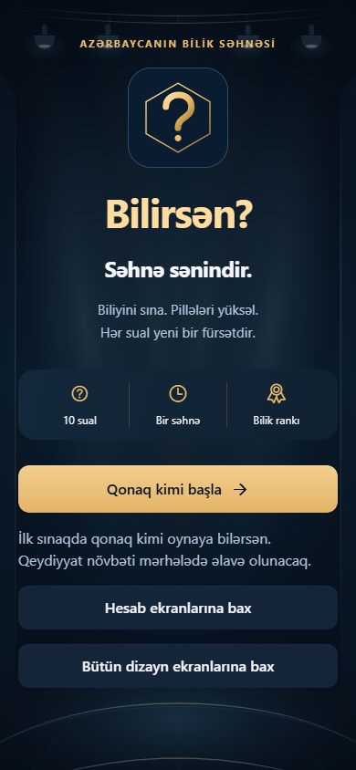
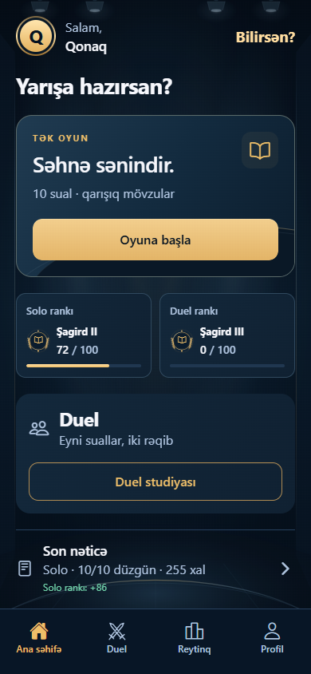
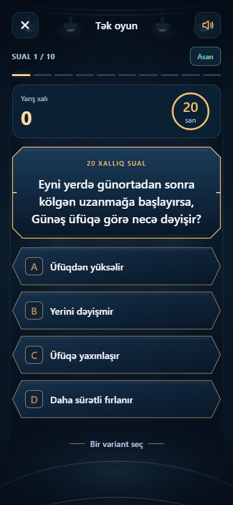
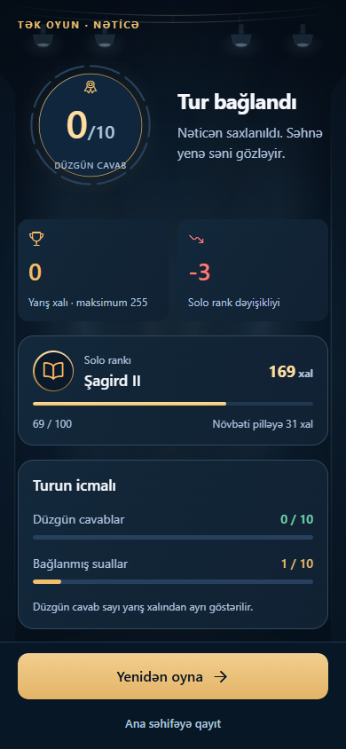
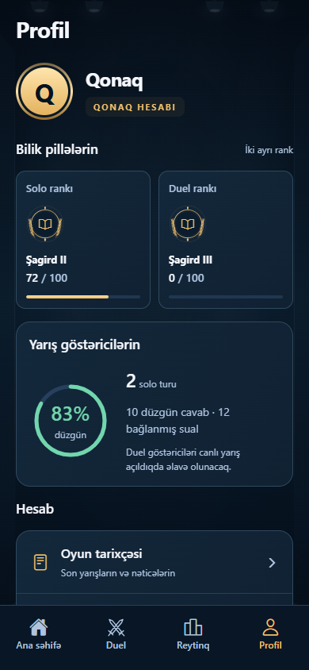
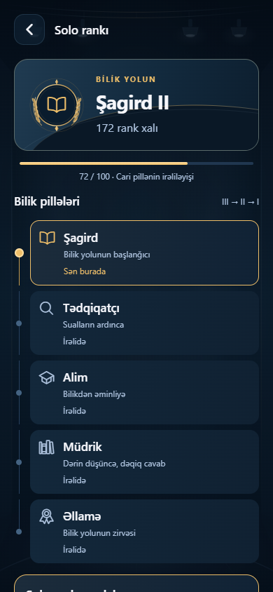
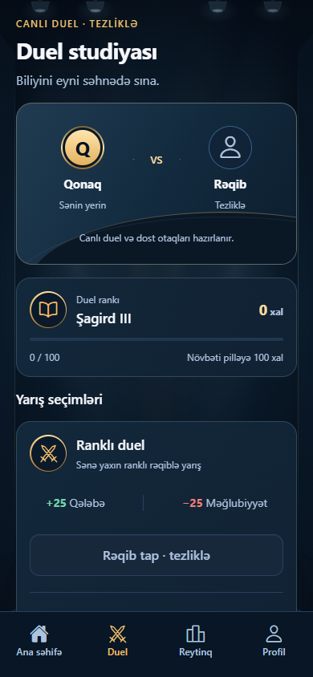
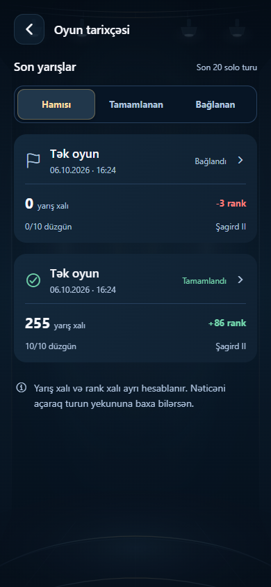

<p align="center">
  
</p>

<h1 align="center">Bilirsən?</h1>

<p align="center">10 sual. Bir səhnə. Bilik yarışı.</p>

<p align="center">
  <a href="#ekranlar">Ekranlar</a> ·
  <a href="#oyun">Oyun</a> ·
  <a href="#işə-salmaq">İşə salmaq</a> ·
  <a href="#layihənin-quruluşu">Kodun quruluşu</a>
</p>

**Bilirsən?** Azərbaycan dilində mobil bilik yarışıdır. Məqsəd bir neçə dəqiqəlik oyunda həm bildiklərini sınamaq, həm də yeni bir şey öyrənməkdir. Suallar qarışıq mövzulardan gəlir; kateqoriya seçmək əvəzinə birbaşa yarışa başlayırsan.

Görünüş üçün televiziya studiyası üslubu seçilib: tünd göy səhnə, qızılı vurğular, işıqlar və xüsusi sual çərçivələri. Vaxt azaldıqca arxa fondakı ritm sürətlənir. Düzgün və yanlış cavabların ayrıca səsi var; hamısını tənzimləmələrdən söndürmək mümkündür.

Layihə hazırda **0.1.0** inkişaf mərhələsindədir. Qonaq kimi solo oyun işləyir. Canlı duel, qeydiyyat və rəsmi reytinq növbəti mərhələlərə saxlanıb.

## Ekranlar

Aşağıdakı şəkillər tətbiqin son Studio dizaynından, iPhone ölçüsünə uyğun **390 px enli brauzer görünüşündən** götürülüb. Nümunə hesab və nəticələr istifadə olunur; bunlar fiziki iPhone ekran çəkilişləri deyil.

<table>
  <tr>
    <th>Qarşılama</th>
    <th>Ana səhifə</th>
    <th>Sual</th>
  </tr>
  <tr>
    <td></td>
    <td></td>
    <td></td>
  </tr>
  <tr>
    <th>Tur nəticəsi</th>
    <th>Profil</th>
    <th>Bilik pillələri</th>
  </tr>
  <tr>
    <td></td>
    <td></td>
    <td></td>
  </tr>
</table>

<details>
<summary>Duel studiyası və tarixçə</summary>

<table>
  <tr><th>Duel studiyası · xidmət hazırlanır</th><th>Yarış tarixçəsi</th></tr>
  <tr>
    <td></td>
    <td></td>
  </tr>
</table>

</details>

## Oyun

Hər solo tur **10 sualdan** ibarətdir: 2 asan, 5 orta, 3 çətin. Hər sualın dörd variantı və bir düzgün cavabı var.

| Çətinlik |      Vaxt | Düzgün cavabın yarış xalı | Solo rank: düzgün / yanlış |
| -------- | --------: | ------------------------: | -------------------------: |
| Asan     | 20 saniyə |                        20 |                    +5 / −3 |
| Orta     | 25 saniyə |                        25 |                    +8 / −4 |
| Çətin    | 30 saniyə |                        30 |                   +12 / −5 |

Vaxt bitəndə sual cavabsız bağlanır və növbəti suala keçilir. Cavabsız suala görə rank dəyişmir. **Yarış xalı** həmin turun nəticəsidir; **rank xalı** isə turlar arasında saxlanan irəliləyişdir. Turun maksimum yarış xalı 255-dir.

Rank yolu: **Şagird → Tədqiqatçı → Alim → Müdrik → Əllamə**. Hər pillənin III, II və I alt pillələri var. Solo və duel rankları ayrıdır.

Cavabın qəbulunu, vaxtı, nəticəni və rank dəyişikliyini server idarə edir. Telefon serverin təsdiqlədiyi vəziyyəti göstərir. Cavab açarı mobil tətbiqə göndərilən sualda yoxdur.

## Hazır olanlar və növbəti işlər

| Hazır olanlar                                       | Növbəti mərhələ                               |
| --------------------------------------------------- | --------------------------------------------- |
| Qonaq sessiyası və cihazda sessiyanın saxlanması    | E-poçt, şifrə və istifadəçi adı ilə qeydiyyat |
| Serverdə idarə olunan solo tur                      | Canlı duel və dost otaqları                   |
| PostgreSQL-də nəticə və solo rankın saxlanması      | Solo və duel üçün rəsmi reytinq siyahıları    |
| Son 20 turun tarixçəsi və profil göstəriciləri      | E-poçt təsdiqi, bərpa və hesab idarəetməsi    |
| Studio ekranları, səs ayarları və dizayn nümunələri | Mağaza yayımı və tam cihaz yoxlamaları        |

Sual bankında **1.950 hazırlanmış sual** var; hədəf 10.000-dir. Yerli tətbiq sınağı üçün 120 sual ayrıca `test_only` statusu ilə seçilir. Bankdakı `review_ready` statusu ictimai yayım təsdiqi deyil. Bankın öz [iş qaydaları və mənbələri](question-bank/README.az.md) ayrıca sənədləşdirilib.

## Texnologiyalar

| Hissə              | İstifadə olunanlar                                 |
| ------------------ | -------------------------------------------------- |
| Mobil tətbiq       | React Native, Expo SDK 57, Expo Router, TypeScript |
| Məlumat və sessiya | TanStack Query, Zustand, Expo SecureStore          |
| Görünüş və səs     | React Native SVG, Expo LinearGradient, Expo Audio  |
| Server             | NestJS, Prisma 7, PostgreSQL 18                    |
| Ortaq müqavilələr  | Zod, strict TypeScript                             |
| Yoxlamalar         | Vitest, Playwright, ESLint, Prettier               |

## İşə salmaq

**Node.js 22.13+**, Docker Desktop və telefonda Expo Go lazımdır. Əmrlər repo kökündə işlədilir.

```powershell
git clone https://github.com/IsrafilIsakhli/Bilirsen.git
cd Bilirsen
npm ci
npm run generate
```

Yeni kompüterdə database və sual bankı ilk dəfə hazırlanmalıdır. Bunun üçün [yerli quraşdırma təlimatını](docs/development/LOCAL-SETUP.az.md) izlə. Mövcud database ilə davam edirsənsə, məlumatları yenidən idxal etməyə ehtiyac yoxdur.

Mobil bağlantını hazırla:

```powershell
Copy-Item apps/mobile/.env.example apps/mobile/.env.local
```

`apps/mobile/.env.local` faylındakı `EXPO_PUBLIC_API_URL` dəyərini kompüterin Wi-Fi IPv4 ünvanı ilə dəyiş: `http://KOMPÜTERİN_IP_ÜNVANI:3000/v1`. Telefonda `localhost` kompüterə yönəlmir.

İki ayrı terminal aç:

```powershell
npm run dev:api
```

```powershell
npm run dev:mobile
```

Telefon və kompüter eyni Wi-Fi şəbəkəsində olsun. Expo-nun göstərdiyi QR kodu Expo Go ilə aç. iPhone-da kamera, Android-də Expo Go-nun QR oxuducusu ilə başlaya bilərsən. Layihənin ayrıca QR səhifəsini yaratmaq üçün:

```powershell
npm run phone:link
```

Bu əmrdən sonra `output/testing/phone/BAXIS.html` faylını aç. İlk oyuna **“Qonaq kimi başla”** ilə daxil ol. Telefon sınağı zamanı Expo və oyun serveri açıq qalmalıdır. Bağlantını telefondan `http://KOMPÜTERİN_IP_ÜNVANI:3000/v1/health` ünvanı ilə yoxlamaq mümkündür.

## Layihənin quruluşu

```text
apps/
  mobile/          Expo tətbiqi, ekranlar, ortaq komponentlər və səslər
  api/             NestJS serveri, oyun qaydaları və database əməliyyatları
packages/
  contracts/       Mobil və server arasında açıq məlumat müqavilələri
question-bank/     Suallar, mənbələr, yoxlama qeydləri və idxal faylları
docs/              Dizayn, quraşdırma və sınaq qeydləri
scripts/           Yerli quraşdırma, səs və təqdimat alətləri
```

Route və controller faylları keçidləri və sorğuları idarə edir. Oyun qaydaları serverin domain/application hissəsindədir. Mobil ekranlar ortaq tema və komponentlərdən istifadə edir. Arxitekturanın qərarları [KOD-ARXITEKTURASI.az.md](KOD-ARXITEKTURASI.az.md), oyun qərarları isə [MOBIL-TƏTBİQ-PLANI.az.md](MOBIL-TƏTBİQ-PLANI.az.md) faylındadır.

## Sənədlər

- [Yerli quraşdırma](docs/development/LOCAL-SETUP.az.md) — yeni kompüterdə database, API və telefon bağlantısının hazırlanması.
- [Tətbiqin arxitekturası](KOD-ARXITEKTURASI.az.md) — modulların məsuliyyətləri və serverdə idarə olunan oyun axını.
- [Sual bankı](question-bank/README.az.md) — sualların hazırlanması, mənbələr və yoxlama qaydaları.
- [Sınaq qeydləri](docs/testing/ILK-MERHELE.az.md) — yoxlanmış davranışlar və yayım üçün qalan işlər.

## Yoxlamalar

```powershell
npm run check
npm run format:check
```

`check` TypeScript, lint və adi testləri işlədir. Canlı database/API inteqrasiya sınaqları ayrıca aktivləşdirilir; [ilk mərhələ qeydlərində](docs/testing/ILK-MERHELE.az.md) onların əhatəsi göstərilib.

Brauzer sınaqları və Android/iOS/web paket ixracı:

```powershell
npm run test:ui
npm run export -w @azquiz/mobile
```

Brauzer sınaqları quraşdırılmış Chrome-dan istifadə edir; başqa yerləşmə üçün `CHROME_PATH` verilir. Paket ixracı mağaza yığımı və fiziki telefon sınağı demək deyil.

`.env` faylları, yerli database parolu, ehtiyat nüsxələr və yığım çıxışları repoya daxil edilmir. PostgreSQL yerli quraşdırmada yalnız kompüterin `127.0.0.1:5432` ünvanında açılır; mobil tətbiq database ilə deyil, API ilə danışır.
